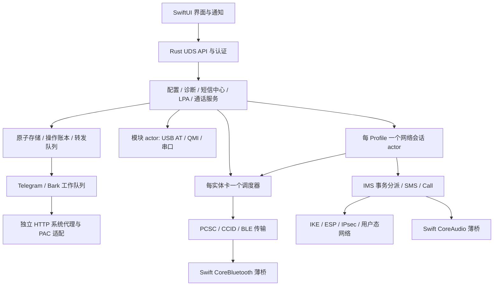

# Switch 全 Rust 后端改造方案

> **执行更新（2026-10-25）：** 批准的全 Rust 目标与功能范围继续有效；当前软件快照为3.51/build351，来源状态 `source-not-final-G0B`。当前 Rust业务owner、Swift系统桥、codec FFI和审计计数见[当前运行时所有权](all-rust/README.md#current-runtime-ownership)，整改状态见[当前进度](all-rust/progress-current.md)。下方605等“当前/最新”条目保留为各自时期历史原文，不代表本轮来源、最终软件验收或长稳通过。G0B/G8/G9仍NO_GO、正式长稳0小时、P0未闭合、P1–P4验收中、P5/P6开放；不冻结整体分母，不生成DMG。

> **当前项目目标与唯一有效工作区：** `/Users/StatTrak/Desktop/Switch_MAC/`；可编辑源码为 `/Users/StatTrak/Desktop/Switch_MAC/src/`，构建、测试和运行数据位于 `/Users/StatTrak/Desktop/Switch_MAC/build/`，发行物位于 `/Users/StatTrak/Desktop/Switch_MAC/dist/`。这条路径取代早期目标中 `/Users/proletarius/Desktop/Switch/` 的写入地址。旧迭代记录保留当时路径作为历史证据，不代表当前工作目录。

当前工作包605（2026-10-21）：唯一工作目录为 `/Users/StatTrak/Desktop/Switch_MAC/`，源码/构建/发行物分别位于 `src/`、`build/`、`dist/`。Iteration 604 的 SIM World 454/03 实卡 VoWiFi IMS 注册结果及安全清理保持有效。Iteration 605 修复读卡器 eSIM 下载 detached worker 未持有共享操作闸门的并发缺口：闸门随 worker 移交，并在物理租约释放和最终读卡器刷新后释放；读卡器 eSIM 专项51项测试通过，新增回归验证操作日志已终态而 owner 清理仍未结束时，模块写操作继续被拒绝。Rust fmt 检查通过。未执行实体下载、切换 Profile、收发短信或拨号，未生成 DMG。严格 Rust-only 静态盘点仍为294/294 Rust owner、0 Go owner；P0分母/历史支持成员尚未闭合，P1–P4验收中，P5语音与P6最终验收未完成，不报告总体百分比。当前读写路径已统一至 `Switch_MAC/src`、`build`、`dist`；Codex内部 goal objective 仍含旧地址，而可用工具没有 objective 文本编辑接口。见[Iteration 605](all-rust/iteration-605-reader-download-gate-lifetime.md)、[Iteration 604](all-rust/iteration-604-simworld-vowifi-registration.md)、[路径修正记录](all-rust/iteration-601-workspace-path-and-source-map-refresh.md)及[整体进度](all-rust/progress-current.md)。

历史工作包586（2026-10-19）：耐久USB观察已入正常Intent，隔离启动接入独立有限metadata owner、held-FD完整证据及仅开既有双锁；实际释放后只留只读witness，未授予物理恢复权利。daemon 2848项通过、2个进程helper另验，定向87项、真实死亡/重启8阶段16进程通过。接口294/294由Rust接管。Release后端及包内验证通过，复用未变581 GUI/Swift；精确清理2条缓存路径、1698058240字节。未安装、无DMG、无实机。metadata到原生恢复的有限策略/实际清理/receipt/解封、helperboot及route绑定、legacy共享生命周期和完整实机/长稳/升级/性能仍待验收。见[586证据](all-rust/iteration-586-startup-metadata-foundation.md)及[整体进度](all-rust/progress-current.md)。

历史工作包579（2026-10-19）：共享模块准入现可单调撤销新业务，并保留已接纳有限任务的真实清理；语音跨请求保留原ADB计划与待结算义务，未接纳RF任务用类型化回执释放原占用。完整daemon2629项通过（新增51项），API/Go退出、Release后端候选、包内17场景23进程及新增live撤权/正常退出、三种日志退出、10模式向量通过；复用未变的578 GUI。清理约1.37GB可重建缓存。启动恢复权利、legacy并发生命周期、串口/重枚举物理绑定、跨语言落盘及实机业务仍未闭合；安装应用与正式dist不变，无DMG。整体仍为P1–P4同步验收、P5完善、P6未完成，294/294仅接口接管。见[579证据与边界](all-rust/iteration-579-live-admission-and-settlement.md)和[整体进度](all-rust/progress-current.md)。

历史工作包578（2026-10-19）：已打开原生USB AT的语音准备/route现持有同连接Device，并在transition租约安装时原子核对owner、producer、session及代次；修复计数耗尽遗留租约。完整daemon2578项通过（新增23项），API/生产Go退出、Release后端候选、包内17场景23进程、日志退出及10模式向量通过；复用未变的577 GUI。清理约1.35GB编译缓存。无AT/串口、重枚举、共享authority、真实跨语言落盘及实机业务仍未完成；安装应用与正式dist不变，无DMG。整体仍为P1–P4同步验收、P5完善、P6未完成，294/294仅接口接管。见[578证据与剩余验收](all-rust/iteration-578-usb-adb-connection-binding.md)和[整体进度](all-rust/progress-current.md)。

历史工作包577（2026-10-19）：本轮将一次 ADB 计划固定到原生目标，并冻结备份恢复输入、拒绝路径/内容替换；修复 schema 2 附加 voice 被误恢复的问题。完整 daemon 2555 项通过，生产 Go 退出及 API 门禁、Release 后端候选、包内17场景23进程、三种日志退出与10模式向量通过；本轮复用未改动的576 GUI，没有重新编译Swift。清理两项编译缓存及633个旧Go缓存条目，合计约1.47GB分配空间。共享模块 authority、真实跨语言落盘及实机/运营商验收仍未完成；安装应用与正式dist不变，无DMG。整体仍为P1–P4同步验收、P5完善、P6未完成，294/294仅接口接管。见[577证据与剩余验收](all-rust/iteration-577-adb-plan-and-restore-input.md)和[整体进度](all-rust/progress-current.md)。

历史工作包576（2026-10-19）：读卡器自动选择统一采用同响应的卡片观测，保留 owner 与独立 BLE 回退已补齐；App 正常退出等待实际后端退出再关闭蓝牙桥，并阻断退出期间重启。43 个 Rust 程序常规3370通过/1失败/1忽略；PAC专项6通过，去重3371项有通过证据，真实跨语言落盘前置仍未通过。完整 Swift reader/menu/退出测试、独立 Release 候选、包内17场景23进程、三种日志管道退出及10模式向量通过。清理7项缓存约2.20GB；安装应用与正式dist不变，无DMG。整体仍为P1–P4同步验收、P5完善、P6未完成，294/294仅接口接管。见[576证据与剩余验收](all-rust/iteration-576-discovery-and-app-exit.md)和[整体进度](all-rust/progress-current.md)。

历史工作包575（2026-10-19）：修复读卡器真实在位/身份发布围栏、前端未知状态与关闭操作竞争，以及短信转发缓存重试绕过持久化失败。43个Rust测试程序实际执行；3369个不同用例已有通过证据（原沙箱PAC失败与专项对照分别保留），另1项真实跨语言持久化前置未通过。完整Swift readiness和旧/新源码失败关闭对照通过；完整Release候选、签名、包内退出及10模式向量对照通过；清理7项缓存约2.14GB，无DMG。见[575证据与剩余验收](all-rust/iteration-575-reader-presence-and-durable-handoff.md)和[整体进度](all-rust/progress-current.md)。整体仍为P1–P4同步验收、P5完善、P6未完成，294/294仅接口接管。

历史工作包574：完整daemon软件测试2518通过；全工作区3345个不同Rust用例已有通过证据，另1项跨语言前置受隔离偏好设置持久化失败阻挡，未计通过。当前完整候选、包内退出和EVS/WB向量检查通过；实机ESTK卡片在位但MUTE、无ATR，未取得USIM身份或进入IMS注册。旧安装应用已恢复，清理12项精确缓存约3.78GB，无DMG。见[574证据与剩余验收](all-rust/iteration-574-software-acceptance-and-reader.md)和[整体进度](all-rust/progress-current.md)。整体仍为P1–P4同步验收、P5完善、P6未完成，294/294仅接口接管。以下迭代条目保留各自当时的历史结果，不覆盖本条当前状态。

历史工作包（Iteration573，2026-10-19）：当前daemon数据目录/监听路径互斥与运行中媒体死亡的撤桥/真实退出验证完成；338项定向Rust、16项真实native故障、17场景23进程及完整候选通过。用户已要求P1–P6全部验收，P1–P4同步推进：当时全量daemon软件门禁2377通过/141失败，失败分类见[573证据](all-rust/iteration-573-daemon-and-media-lifetime.md)，后续结果见上方574。

最新进展（Iteration572，2026-10-19）：补齐EVS/WB原生初始化失败传播、partial cleanup与异常ready通道真实join；150个实际分配失败点、10种模式向量对照、5项真实worker故障通过。普通301项Rust、Swift模拟29项及冻结协议297次通过。整体仍为P5完善、P6未收口，接口接管100%（294/294）单列。见[Iteration572](all-rust/iteration-572-native-codec-failure-review.md)及[整体进度](all-rust/progress-current.md)。native运行期/OS故障、实网业务/升级回退/长稳/性能等仍待验收。不生成DMG。

上一工作包（Iteration571，2026-10-19）：实现独立负向INVITE/Completed事务、严格branch ACK/CANCEL隔离及期限/容量保护，修复Contact wildcard接纳、TCP Via匹配不一致与生产夹具业务屏障测量。301项定向Rust、29项Swift模拟音频场景及297次协议回放通过，本地生产组合仍精确核对七条通话历史与真实EVS/WB媒体。见[Iteration571](all-rust/iteration-571-completed-invite-review.md)。

上一工作包（Iteration570，2026-10-19）：补齐初始UAS可靠180/PRACK三条真实媒体协商、独立重传/事务缓存及早期UPDATE在接听时的状态保留，修复早期终结的writer/清理边界。276项定向Rust、29项Swift模拟音频场景与297次协议回放通过，本地生产组合精确七条通话历史。见[Iteration570](all-rust/iteration-570-reliable-provisional.md)。

最新进展（Iteration 569，2026-10-19）：实现初始offerless来电的冻结200 offer、真实EVS/AMR-WB接收准备与ACK一次提交，补齐Swift提前只接收附着、未知写入清理及未关联PRACK围栏。252项定向Rust回归、29项Swift模拟音频场景和297次冻结协议回放通过。整体仍为P5完善、P6未收口，接口接管100%（294/294）单列；完整UAS可靠1xx、多non-2xx故障矩阵及实网/升级回退/长稳/性能待验收。见[Iteration569](all-rust/iteration-569-initial-offerless.md)及[整体进度](all-rust/progress-current.md)。不生成DMG。

最新进展（Iteration 568，2026-10-19）：通话内re-INVITE的Accepted身份与媒体分离，保留多个旧事务、独立200定时重传、严格ACK与退休dialog隔离，补齐未知写入及BYE写失败仍释放媒体。225项定向Rust测试、297次冻结协议回放通过；整体仍为P5完善、P6未收口，接口接管100%（294/294）单列。见[Iteration568](all-rust/iteration-568-accepted-reinvite-lifecycle.md)及[整体进度](all-rust/progress-current.md)。完整non-2xx/初始offerless矩阵、实网业务、升级回退、长稳和性能待验收；不生成DMG。

最新进展（Iteration 567，2026-10-19）：补齐初始呼入200的T1/T2重传、ACK前接收和TX门控，以及挂断/CANCEL/BYE、旧事务和未知写入竞争；206项定向Rust回归、24项Swift模拟音频场景、297次冻结协议回放通过。整体阶段为P5完善、P6验收未收口，接口接管100%（294/294）不等于全项目完成率。详见[Iteration567](all-rust/iteration-567-initial-answer-lifecycle.md)和[整体进度表](all-rust/progress-current.md)。通话内Accepted事务剩余边界、实机/实网、升级回退、长稳与性能仍待完成；本轮不生成DMG。

最新进展（Iteration 566，2026-10-18）：实现通话内 re-INVITE/UPDATE 的 EVS↔AMR-WB 实际媒体重新协商、严格保留 offer 验证、旧包有序接收及 DTMF/失败清理屏障；补齐 Contact/租期在成功回执时应用及迟到 ACK 隔离。186 项定向 Rust 测试、297 次冻结协议回放和当前真实 daemon 的三种日志管道退出通过，2,851 项输入零漂移、Go 调用陷阱未触发。详见 [Iteration566](all-rust/iteration-566-media-renegotiation.md)。这不是完整 P5/P6：下一软件工作包仍有初始呼入 200 重传/ACK 前接收与竞争；实网业务、自然租期长稳、生产回退共享生命周期及性能仍待验收。未生成 DMG或替换已安装应用，构建缓存验证后清理。

上一工作包（Iterations 564–565，2026-10-18）：补齐备注文件未知字段/精确数值的持久化保留，并让日志满管道不再阻塞通信与退出 owner；有界日志队列、原有错误/DTO 边界、合成数据与实际 daemon 的强制沙箱验证见 [Iteration564](all-rust/iteration-564-notes-and-nonblocking-diagnostics.md)。同时形成 [P5 编码重协商实施审议](all-rust/iteration-565-p5-renegotiation-residual.md)，后续实施及当前边界以 Iteration566 为准。生产回退生命周期 authority、实机业务、长稳与性能验收保持未完成。

最新实现（Iterations 562–563，2026-10-18）：Rust 已接入 AMR-WB 运行中 CMR、完整 mode-set、period/neighbor 限制与同一编码器的帧边界切换；本地完整 IKE/ESP/IMS/RTP/PCM 调用链中验证连续 8→2→8、保留/集合外请求及 RTP 连续性，未做实网呼叫。另补充旧程序启动前持久 pending 的强制沙箱验收工具与新版模块 Gate，完整包在 pending+pristine 共存时能隔离模块且正常退出；生产并发回退仍须共享生命周期 lease，旧 3.42 的退出 1 保持未通过。见 [CMR 实现与验证](all-rust/iteration-563-amr-wb-cmr.md)、[pending 离线边界](all-rust/iteration-562-guarded-legacy-pending.md)。此前 557–560 的具体受测二进制已完成 SIM World 实卡 IMS 注册，见 [实卡证据](all-rust/iteration-557-simworld-nat-notify-registration.md)。以下旧条目为历史快照；未完成的实机、升级回退、长稳和性能验收仍不得计为100%，本轮无DMG。

最新端口排除（Iteration 554，2026-10-18）：隔离诊断版在 SIM World 同卡与固定成功 ePDG/Surge 路径下记录到最终已验证 IKE 回包来源端口=首个 ESP 目的端口=4500，而 IMS 仍未注册、ESP 8 发/0 收。故这次会话的故障不由 NAT-T 端口未跟随解释；诊断补丁未进生产。下一步验证真实 CHILD/CFG_REPLY 与首个 ESP 的非敏感完整性和内层目标关系。见 [Iteration 554](all-rust/iteration-554-simworld-natt-port-diagnostic.md)。

最新 IKE 兼容（Iteration 553，2026-10-18）：已补齐旧 Go 客户端可选的 3GPP DEVICE_IDENTITY(41101) 首次 IKE_AUTH 通知，沿用现有运营商开关与冻结 IMEI，离线字节 fixture 和 3HK 回环测试通过。其对 SIM World ESP 零回包是否有作用仍需固定 ePDG/代理的单变量实卡验证，不能把实现视为注册通过；见 [Iteration 553](all-rust/iteration-553-ike-device-identity-parity.md)。

最新实卡 A/B（Iterations 550–552，2026-10-18）：SIM World 已确认为 3HK 454/03。同一卡、同一 Surge 香港家宽节点和归档 2.86 成功使用的 ePDG 地址下，旧 Go 客户端完成 IMS 注册，当前 Rust 客户端的 ESP 为 8 发/0 收，IMS TCP 建连超时，形成明确的当前实网回归。下一步对照认证后 UDP 端口、CHILD 参数和内层目标；不得把离线 CBC 合成测试当成实网成功。上游 `use_ipsec:false` 与 iOS 语义已补入 Rust 的 IMS 策略，3HK 报文仍保持原样。证据见 [550](all-rust/iteration-550-simworld-286-comparison.md)、[551](all-rust/iteration-551-ims-use-ipsec-policy.md)、[552](all-rust/iteration-552-simworld-286-rust-registration-ab.md)。仍需在修复后重做 SIM World 注册、短信/通话和 P6 验收；中途不生成 DMG。

最新进展（Iterations 546–549，2026-10-18）：已把运营商上游 `main@09b8ae86` 锁定到 Rust 配置资料库，保留历史选择规则并复核 SIM World=3HK 454/03 及本机 iOS 协议字段；新出现而当前无法展开的 Verizon Ting 身份变量已由兼容层隔离。旧 3.42 与当前 Rust 在强制硬件/外网沙箱下完成合成持久化数据和 SWF1 转发队列的读写/取消/回退循环；SIM World 所协商 CBC 的 EAP→CHILD→ESP→TCP SYN 离线组合测试也通过。证据见 [546](all-rust/iteration-546-sandboxed-data-roundtrip.md)、[547](all-rust/iteration-547-carrier-refresh.md)、[548](all-rust/iteration-548-simworld-cbc-composition.md)、[549](all-rust/iteration-549-sandboxed-forwarding-roundtrip.md)。这仍不能替代 SIM World 实网 IMS/短信/通话、已安装应用原位升级回退及长期验收；整体目标继续推进，中途不生成 DMG。

最新实卡排除（Iteration 544，2026-10-18）：隔离 A/B 证明仅将 Rust 透明 UDP socket 改为旧 Go 式未连接接收，不能改善 SIM World CHILD SA 后零入站；实验已撤回，原 Release 后端重建。下一步需要代理出口/ePDG 侧证据或同卡同网已知正常客户端对照。见 [Iteration 544](all-rust/iteration-544-simworld-udp-port-ab.md)。无 DMG。

最新进展（Iteration 542，2026-10-18）：隔离的完整 SwiftUI 应用在同一数据目录连续两次启动、正常退出；每次均拉起包内 Rust 后端并创建私有后端/BLE socket，退出后进程与两个 socket 均清理。错误令牌被拒绝，隔离应用与数据已删除。真实蓝牙卡重连和运营商业务仍待验收。见 [Iteration 542](all-rust/iteration-542-two-launch-ble-cleanup.md)。无 DMG。

最新进展（Iteration 541，2026-10-18）：BLE 桥正常退出时清理自有 socket，绑定失败及旧实例路径替换时不删除其他监听器的 socket；生产桥无硬件生命周期回归和完整 SwiftUI/Rust Debug 构建通过。真实 BLE 设备重连、SIM World IMS/短信/通话及其他 P6 验收仍待完成，当前整体完成率不作无依据百分比估算。见 [Iteration 541](all-rust/iteration-541-ble-bridge-lifecycle.md)。无 DMG。

最新进展（Iteration 539，2026-10-18）：隔离启动完整 SwiftUI 应用，UI 显示包内 Rust 后端运行中，实际读取 ESTKme-RED 的 SIM World 与 10 个 Profile；N待和短信中心页面加载、正常退出后主程序及 Rust 子进程均结束。测试使用临时 Bundle ID，正式安装、旧数据升级回退与运营商业务仍未验收。见 [Iteration 539](all-rust/iteration-539-swiftui-bundled-rust-smoke.md)。无 DMG。

最新进展（Iteration 538，2026-10-18）：包内 Rust 后端在独立数据目录完成 SIM World 实卡 IKE/EAP；IMS `plain_connect` 超时，ESP 发出 8、收到 0，香港家宽代理入站总字节无法证明 ESP 回程。新增有运营商匹配门禁的脱敏实卡探针，见 [Iteration 538](all-rust/iteration-538-simworld-bundled-backend.md)。短信、通话未验收，无 DMG。

最新进展（Iteration 537，2026-10-18）：当前 SwiftUI 与 Rust 后端一体化 macOS Release 构建成功，包内仅嵌入 Rust 后端及 libusb；签名、架构、动态依赖和包内 daemon 无设备启动/退出通过。仍需干净环境、升级回退及真实业务验收。见 [Iteration 537](all-rust/iteration-537-integrated-app-build.md)。未生成 DMG。

最新进展（Iteration 536，2026-10-18）：Rust 隧道诊断新增 CHILD SA 后的入站包分类；ESTKme-RED + SIM World 实测香港家宽代理路径无任何 CHILD 后入站 UDP，临时精确直连则在 IKE_SA_INIT 超时。两组测试均已清理，直连规则已撤销。网络丢包位置仍需代理出口/ePDG 证据；IMS、短信、通话和长稳仍待验收。见 [Iteration 536](all-rust/iteration-536-simworld-post-child-rx.md)。无 DMG。

最新进展（Iteration 535，2026-10-18）：修复全新数据目录中只读通话模式探测创建空锁后，Rust daemon 退出误判需要 ADB 物理清理的问题；真实进程退出及 socket 清理回归通过。历史不明锁仍保守处理，SIM World IMS/ESP 实网缺口未关闭。见 [Iteration 535](all-rust/iteration-535-call-mode-pristine-shutdown.md)。无 DMG。

最新进展（Iteration 534，2026-10-18）：隔离 ESTKme-RED + SIM World 确认当前启用号卡、读卡和 IKE/EAP 已通过，IMS 仍因内层 TCP 超时而未注册；Rust IMS 通话 owner 补齐刷新 re-INVITE 迟到最终响应的 ACK 及旧通话隔离。测试边界见 [Iteration 534](all-rust/iteration-534-simworld-and-late-refresh-ack.md)。短信、通话和长时间在线仍未通过实机验收，无 DMG。

最新进展（Iteration 533，2026-10-18）：隔离 ESTKme-RED + SIM World 复测仍为隧道成功、IMS `plain_connect` 超时、ESP 8 发/0 收；Rust IMS owner 同步补齐不支持 UPDATE 时的 re-INVITE 会话刷新与事务边界，离线回归和实卡限制见 [Iteration 533](all-rust/iteration-533-simworld-and-session-refresh.md)。IMS、短信、通话实网验收仍未完成，无 DMG。

最新进展（Iteration 532，2026-10-18）：Rust 主叫初始 INVITE 增加有界 422/Min-SE 新事务重试，保持媒体绑定、旧事务 ACK 与取消语义；完整回归及接口门禁结果见 [Iteration 532](all-rust/iteration-532-initial-invite-422.md)。本轮无 DMG。

最新进展（Iteration 531，2026-10-18）：按 RFC 4028 修正 Rust 通话会话定时器的成功刷新语义和入站 INVITE 重传/错误头处理；SIM World 的 IMS TCP 与 ESP 回程问题仍待实机定位。见 [Iteration 531](all-rust/iteration-531-rfc4028-timer-correction.md)。本轮无 DMG。

最新进展（Iteration 530，2026-10-18）：已修复会话清理后安全诊断被状态页覆盖的问题。隔离 ESTKme-RED + SIM World 再测得到 IMS `plain_connect` 超时和实际 ESP 8/0/0 计数；运营商业务验收仍未完成。见 [Iteration 530](all-rust/iteration-530-simworld-diagnostic-retention.md)。本轮无 DMG。

最新进展（Iteration 529，2026-10-18）：Rust IMS 通话 owner 增加已协商会话的定时刷新、422 Min-SE 重试和到期清理；本地事务测试已覆盖主要路径。隔离 ESTKme-RED + SIM World 复测仍在 IMS 注册网络传输阶段失败；本次未取得新的 ESP 计数，运营商实机业务验收未完成。见 [Iteration 529](all-rust/iteration-529-ims-session-timer.md)。本轮无 DMG。

最新 ESP 边界核对（Iteration 528，2026-10-18）：新增与 SIM World 协商套件一致的 AES-256-CBC/HMAC-SHA256-128 受控 SOCKS5 UDP 4500 双向测试，验证 ESP 发送、收包分类及解密；未改变实卡 Surge 透明代理路径，IMS 故障仍未定位。见 [Iteration 528](all-rust/iteration-528-cbc-socks-ingress.md)。无 DMG。

最新 SIP 事务核对（Iteration 527，2026-10-18）：Rust IMS owner 的 re-INVITE 拒绝响应按 Via/CSeq 缓存，使 400/415/488 的同事务重传保持原状态，通话和媒体不受影响。见 [Iteration 527](all-rust/iteration-527-reinvite-retransmission.md)。SIM World 实卡 IMS 故障未解决；无 DMG。

最新语音会话核对（Iteration 526，2026-10-18）：无 SDP re-INVITE 已改由 Rust 通话 owner 在 200 中发送 SDP offer，ACK 答案确认后才切换媒体；错误答案触发 BYE 和媒体回收。见 [Iteration 526](all-rust/iteration-526-offerless-reinvite.md)。SIM World 实卡 IMS 故障未解决；无 DMG。

最新语音会话核对（Iteration 525，2026-10-18）：同对话 SDP re-INVITE 已由 Rust owner 处理并在 ACK 后切换媒体目标，新增主叫/被叫、重传、拒绝和超时回归；不代表完整 session timer 或 SIM World 实卡通话验收。见 [Iteration 525](all-rust/iteration-525-in-dialog-reinvite.md)。无 DMG。

最新离线数据面核对（Iteration 524，2026-10-18）：用户态 IP 设备产生的 IPv4 TCP SYN 通过独立 IP/TCP 校验和核对；AES-CBC/HMAC-SHA256 数据面方向键回归扩至 256 位，281 个 VoWiFi crate 测试通过。代理出口/ePDG 侧 ESP 收包仍未知。见 [Iteration 524](all-rust/iteration-524-inner-ip-checksum.md)。无 DMG。

最新实卡协商核对（Iteration 523，2026-10-18）：隔离 ESTKme-RED + SIM World 会话确认协商 AES-256-CBC/HMAC-SHA256-128，仍为 `esp_sent=8、esp_received=0`、IMS `plain_connect` 超时；测试后会话清理并撤回临时诊断。见 [Iteration 523](all-rust/iteration-523-simworld-negotiated-child-sa.md)。无 DMG。

最新协议核对（Iteration 522，2026-10-18）：独立 OpenSSL 合成向量核对了 AES-GCM、AES-256-CBC/HMAC-SHA256 的 ESP 线格式及初始 CHILD SA 密钥方向，Rust 后端仍可构建；本轮没有生产路径改动，也不能据此解释 SIM World 入站 ESP 为零。详见 [Iteration 522](all-rust/iteration-522-esp-independent-vectors.md)。无 DMG。

最新实卡网络对照（Iteration 521，2026-10-18）：SIM World 的原 UDP 流已被 Surge 观察到转向 ePDG:4500；独立 4500 流对照收到 IKE 回复，仍没有入站 ESP，IMS TCP 超时。临时实验代码已撤回；须继续取得代理出口/ePDG 或独立 ESP 互通证据，不能据此认定运营商注册完成。详见 [Iteration 521](all-rust/iteration-521-simworld-udp-flow.md)。无 DMG。

最新传输边界（Iteration 520，2026-10-18）：补全仅 Surge Enhanced Mode 开启时的 ePDG DNS 归属和 `utun` 验证；CLI 状态不明时拒绝静默主机 DNS/直连。此改动尚不能证明 SIM World IMS 注册，继续保留 ESP 回程和运营商业务验收缺口。详见 [Iteration 520](all-rust/iteration-520-enhanced-mode-dns-owner.md)。无 DMG。

最新实卡对照（Iteration 519，2026-10-18）：Rust 透明代理回退改用 Surge DNS，不再在配置前置代理时静默转用主机 DNS 或直连。SIM World 对照另一 ePDG 地址和香港家宽节点后仍在 IMS TCP 建连阶段超时，无法宣称 IMS/SMS/通话验收；隧道计数为提交 ESP 8、收到分类 ESP 0。详见 [Iteration 519](all-rust/iteration-519-surge-dns-simworld.md)。无 DMG。

最新实卡诊断（Iteration 518，2026-10-18）：ESTKme-RED + SIM World 454/03 完成 IKE/EAP 和隧道安装后，IMS TCP 建连仍超时；新加的有界计数显示本地提交 ESP 8 个、入站分类 ESP 0 个。它不能单独证明丢包位置，未验证 IMS 注册、短信或通话。详见 [Iteration 518](all-rust/iteration-518-simworld-esp-probe.md)。本轮无 DMG；当前工作副本在 `/Users/StatTrak/Desktop/Switch_MAC/src`。

最新实机进展（Iteration 517，2026-10-18）：ESTKme-RED + SIM World 454/03 再次完成 IKE/EAP 和隧道安装，但 IMS plain TCP 建连超时；两个香港家宽策略均出现同类结果。一次 UDP 端口切换发送方式的隔离对照未改善，实验代码已撤回。待区分 ESP、代理转发与 P-CSCF 目标，不宣称 IMS/SMS/通话验收。详见 [Iteration 517](all-rust/iteration-517-estk-simworld-retest.md)。无 DMG。

最新源码进展（Iteration 516，2026-10-18）：Rust 通话 owner 现在对同编码的带 SDP UPDATE/PRACK 返回真实 SDP 应答、递增本地 SDP 版本，并更新实际 RTP worker 的对端；不支持的媒体明确拒绝。完整 Rust 回归 3025 通过、0 失败、1 忽略，294/294 Rust 接口归属不变。此项只关闭媒体端点更新的一个软件缺口；RFC 4028 会话定时器、完整 re-INVITE、CMR、实卡 IMS 注册与全部业务验收仍未完成。详见 [Iteration 516](../iteration-516-progress.md) 及 [SIM World 实机记录](all-rust/iteration-515-estk-simworld-hardware.md)。本轮无 DMG。

最新进度记录（Iteration 513，2026-10-16）：本轮完成同机隔离源码重建：Rust/Swift/EVS输出全部重新编译，PATH无Go，签名、动态依赖及包内原生启动/退出通过；旧数据和SWF1队列新增3项真实独立进程恢复测试。完整Rust回归3010通过/0失败/1忽略，构建审计最终自检通过，2853个冻结输入零漂移。修复可选源码快照工具残留的Go版本调用。契约294/294 Rust、127个Swift调用点、429个审阅范围和54条HEAD保持；生产业务代码本轮未变。12项设备/业务验收、完整升级回退、受控性能及自然到期长稳仍待完成。隔离重建不等于全新机器或全功能验收，当前整体百分比不作无依据估算。未生成DMG或替换已安装应用。详见[Iteration 513](../iteration-513-progress.md)。

日期：2026-10-04。启动基线：Switch 2.80 / build 280。

状态：**用户已批准作为持续项目目标，正在实施，未完成。** 终态是零 Go 构建/运行/嵌入依赖，只有所有必需功能及验收完成才标记 100%。中途不生成 DMG，除非用户明确要求。

已交付的 [2.98 / 构建 298](../release-2.98.md) 包含源码至 Iteration 376；该安装包仍包含 Go 后端，不能视为全 Rust 目标完成。历史实现、核算及验证记录保留在各轮进度文档和执行看板，不再将旧百分比称作当前完成率。

## 1. 最终目标与边界

最终交付为 **SwiftUI 前端 + 单一 Rust 后端 `switchd-rs`**：全部后端业务、协议、设备调度、持久化和恢复由 Rust 承担，构建、安装包与运行过程均不再依赖 Go。通过 Rust 调用 Go 静态库或 `c-shared` 不算完成。

- 保留现有界面、交互、短信中心、隐私遮盖、通知和所有当前有效功能，不借语言迁移重新设计 UI。
- 完整迁移模块通信、读卡器、eSIM 管理与正常下载、IMS、VoWiFi/IKE/IPsec、N待、短信收发与转发、现有语音、配置与诊断。
- N待保持短信用途；现有独立语音功能保留。不会通过去掉语音来缩小“全 Rust”范围。
- Swift 保留 UI、CoreBluetooth/GATT、CoreAudio/权限、Keychain 等薄平台适配。Rust 拥有业务会话、身份、代次、调度及重试策略；Swift 不再承担后端业务决策。这里的“全部后端”指后端业务与协议执行层，不要求重写 macOS 系统框架。
- 允许 PC/SC、libusb、CFNetwork/CoreFoundation、经来源核验的 AMR/EVS 编解码库等必要原生 FFI。集中封装句柄、内存、线程和关闭责任，避免重复实现成熟 codec。按用户后续明确要求，主机语音为 EVS 优先、AMR-WB 兼容，不使用 AMR-NB 或 PCMA；成熟 codec FFI 符合全 Rust 业务目标，不能把 Go 库包装为 FFI 视为零 Go 完成。
- 模块端现有原生语音 helper/固件作为明确列出的设备侧依赖保留，Mac 侧控制与恢复迁移到 Rust；本目标不要求重写设备固件或 helper。
- **不实施鉴权绕过**；2026-10-10 用户明确追加的 B0/B1 蓝牙密码与 B0 BF71 兼容认证已作为单独范围纳入并交付 2.96 阶段包（见发行记录），最新用户指示明确排除合作专用加密Profile下载返回6982的路径，不再处理该问题；保留B0/B1密码/BF71认证、蓝牙连接、EID/Profile读取与切换，以及适用的非6982正常下载兼容性。不得绕过鉴权或宣称6982已修复。其余下载、大小确认、安装、通知和失败处理仍须等价迁移。
- 不恢复已删除的传真、关于更新页面、原始参考副本，不增加平台支持范围，不顺带引入新数据库或改云服务协议。
- 当前按用户后续“在 Switch_MAC 继续”的指示，修改与测试/构建材料位于 `/Users/StatTrak/Desktop/Switch_MAC/` 工作区；早期 `/Users/proletarius/Desktop/Switch/` 位置是历史要求，不再作为本阶段写入目标。中途不生成 DMG，除非用户明确要求；完成全部范围并达到最终验收后再按用户既有要求交付最终 DMG。2026-10-06 用户要求修复当前缺口后交付 2.81 阶段包，此次不代表全部迁移完成。

“全 Rust”是用户指定的架构目标，不能因某个模块速度收益不明显就将它永久留在 Go；额外性能改写、依赖替换和 UI 改造仍遵守测量与收益门槛。

## 2. 当前基线：已有 Rust 基础，但核心在线业务尚未接管

本次对当前源码进行了只读核查，并核验 2.80 源码快照。统计包含空行/注释；Rust 统计包含内嵌测试和示例。以下是规模说明，**不能换算为迁移完成百分比**。

| 范围 | 文件数 | 行数 | 解释 |
| --- | ---: | ---: | --- |
| Swift App Sources | 87 | 28,660 | 保留前端，少量启动/平台桥适配 |
| Rust workspace | 115 | 50,818 | 11 个 crate，含现有协议库、存储、测试 |
| 自有 Go 生产代码 | 261 | 70,121 | 尚待逐能力迁移与去重 |
| 自有 Go 测试 | 198 | 35,303 | 转化为行为契约与回归资产 |
| Go vendor 生产代码 | 251 | 55,038 | 含上游和平台分支，不逐行全部翻译 |
| Go vendor 测试 | 127 | 21,432 | 挑选当前可达能力的协议 fixture |

现有 readiness 的“50%”来自粗粒度组件计数，未完整覆盖转发、配置等工作量。后续改用“能力已实现 / 离线已测 / 实机已测 / 已切换 / Go 已退出”五个独立状态。

| 能力 | Rust 可复用基础 | 实际还需完成 |
| --- | --- | --- |
| API、数据和进程 | 公开 UDS、认证、DTO、原子存储、短信和通话档案、发送账本、故障隔离 | 完整健康/配置/诊断/设备接口；去掉默认 Go 路由与 Go 子进程 |
| 读卡器/SIM | PC/SC 枚举、共享句柄、事务、身份绑定 AKA | 持久读卡器 actor、逻辑通道、完整 APDU/LPA、切卡及 BLE 桥 |
| IKE/IPsec | SA_INIT、多轮 EAP-AKA、AUTH、ESP、DPD、IKE DELETE、用户态网络 | daemon 真正持有会话；寿命、重认证、CHILD DELETE/rekey、网络变化恢复 |
| IMS | REGISTER/AKA/sec-agree、安全连接、SIP 解析和连接定向回复 | 常驻事务分派、短信/OPTIONS/NOTIFY、到期与掉线恢复、完整通话事务 |
| 短信/N待 | 编解码、去重拼接、归档、发送意图、N待状态及生命周期模型 | 实际网络收发者、实体卡调度、多 Profile 在线监督与恢复 |
| 语音 | SDP、RTP、AMR/PCMA 辅助和部分外呼状态跟踪 | 来去电 SIP 对话、PRACK、CANCEL/200 竞争、媒体与 DTMF、Swift 音频接线 |
| 模块与 LPA | 可复用领域类型及 API | USB AT/串口、URC、QMI/UIM、可达 MBIM 功能、完整正常 eSIM 下载 |
| Telegram/Bark | 可复用存储/密钥保护和密码算法依赖 | 完整队列、渠道投递、代理/PAC、旧数据与分段状态兼容 |

生产接管门禁目前仍有多项为 false；库能编译、协议单测通过或诊断路径存在，都不等于业务已经转由 Rust 执行。先把已有代码接入真实运行时，不再重复建设另一套协议框架。

此前提到的 `…/gei-w-2/outputs/celmux` 路径本次检查不存在。方案以 Switch 中实际可见的代码为依据，不把无法复核的外部项目算作已可用依赖；后续若重新提供，仅评估其具体模块、平台差异和许可。

## 3. 目标架构

继续使用现有 workspace：`domain`、`api-contract`、`store`、`reader`、`sim`、`sms`、`ike`、`ims`、`vowifi`、`call`、`proletariusd`。按职责补充模块/包，如 modem、LPA、forwarding；只有依赖隔离或独立测试确有需要时才拆 crate，不以 crate 数量作为架构收益。

依赖方向为：API/编排 → 业务服务 → 协议与设备抽象 → 平台适配；DTO 和领域类型不能反向依赖 daemon。协议状态机尽量保持可用虚拟时钟和脱敏输入独立测试。数据包和音频媒体不绕行 HTTP API。

### 3.1 设备、会话与取消规则

1. 每个物理设备一个明确的持有者，负责句柄、命令队列、代次与退出。不同设备可并行；同卡 APDU、应用选择、切 Profile、AKA 必须有序执行。
2. N待是一张卡串行完成身份切换/鉴权、多个 Profile 的网络会话并存。不能为每个 Profile 建立互相冲突的长期独占卡租约。每次操作核对 reader、EID/ICCID、Profile 与 generation。
3. 设备协调器区分短时鉴权、Profile 切换、LPA 写入、复位和在用语音。长写入设置明确的维护状态；不允许 LPA、N待恢复和手工切卡抢占同一物理序列。破坏性操作按现有交互确认并排空冲突任务。
4. 每条 SIP 连接只有一个接收者；按会话代次、连接、Call-ID、CSeq、method/branch 分派，入站回复回到所属连接。短信、保活和通话不能各自抢读 socket。
5. 取消排队请求可以移除任务；已经发出的卡写入、短信或网络提交不能当作“未发生”。记录结果未知，必要时查询当前状态，禁止盲目重放。
6. 旧代先停止接单，再关闭 IMS/IKE/媒体并等待真正退出，最后释放归属。等待超时只能报告仍在退出，不能让新代与旧代同时使用设备。
7. 队列、并发、帧/包、请求正文、日志和连接池均设置上限；事件处理不在 UI 线程或异步执行器线程中执行不可控阻塞调用。

Tokio 已开始执行的 `spawn_blocking` 任务不能通过 abort 强制结束；超时退出等待也不会终止底层调用。长驻硬件循环采用专用线程/受控 worker，短任务有独立并发预算，真实占用必须持续到调用返回。[Tokio 官方文档](https://docs.rs/tokio/latest/tokio/task/fn.spawn_blocking.html)

### 3.2 兼容策略

- **API 先不变。** 保留 Swift 当前路径、字段、日期/可空值、错误码、分页、异步 operation ID、认证与取消语义。必须修改的字段先做版本兼容，不将整个前端重写与后端切换绑定。
- **磁盘格式先不变。** 保留短信、通话、N待、配置、转发队列及未知操作账本。用脱敏旧版本 fixture 验证，不能以 Rust 默认 JSON 序列化假设 Go 的摘要、字段顺序或转义兼容。
- 同一入站事件和发送账本只能有一个消费/写入 owner。迁移、修复损坏存储、重启和版本回退均不得把 `unknown/submitting` 改成可重发；故障隔离状态一并保留。
- **运行能力逐项切换。** 开关必须绑定具体设备/能力和会话代次，不能用一个全局 native-ready 布尔值跳过验收。
- **同一实体资源只能有一个 owner。** 过渡期 Go 和 Rust 可以服务不同设备，但同一设备上的模块、读卡器、N待、LPA 等能力必须协调切换；没有共用可信仲裁就整设备切换，不各自打开句柄。
- **不做双写式影子运行。** 差分比较用离线轨迹/本地测试服务；不同时向卡片、运营商或通知渠道提交两份请求。
- 回退前先排空 Rust 会话再交给旧 owner；结果未知的操作保持冻结，不因切回 Go 自动重试。最终删除 Go 后的回退是恢复上一版完整应用及兼容数据，而不是隐藏保留 Go 兜底。

## 4. 各领域的具体改造

### 4.1 网关、服务、存储与诊断

列出 Go 路由、Swift 调用者、后台定时任务、持久化写入者和退出钩子，形成能力清单。除界面可见功能外，包含运营商覆盖、IMEI/备注、AT 策略、服务顺序、通话模式备份恢复、SIM/ME 短信存储操作、网络诊断、导出、操作事件及错误脱敏。停止、退出及故障恢复后应按原行为恢复无线策略与相关系统设置。

Iteration097已补齐规范路径公开HEAD与21条旧Go派生路径405/Allow兼容，私有接口权限与原生错误语义保持；URL清理、转义段和尾斜线仍待验收。详见[Iteration097](../iteration-097-progress.md)。

补齐 Rust 原生健康接口与真实 ready 状态，避免仍以 Go 健康接口判定启动成功。未知路由在最终版直接返回明确错误，删除默认转发。继续复用现有认证、存储锁、响应大小限制与故障隔离；增加请求接入、读头期限和阻塞任务预算。

实施中的 P1 运行底座已将 UI 公共请求、Go→Rust 原生计算回调、Go→Rust 持久化/控制操作分成三个权限为 `0600` 的 UDS 通道，并分别限制已接收连接任务数量（64/32/16）；退出时只接纳认证的持久结果与资源释放。双进程慢头压力夹具验证公共与计算回调通道满载时，Go 仍能在独立持久化通道完成写入。该预算不覆盖内核 backlog、请求体缓冲和物理设备 actor，完整 P1 仍须继续验收。

保留当前存储方案，不同步引入 SQLite 或改变历史数据目录。迁移脚本必须幂等、可中断、有校验与备份；只有格式确实需要变化时才增加，优先做到无需数据迁移。

### 4.2 短信转发

完整搬迁 Telegram/Bark 的持久任务状态，覆盖接收消息来源、双渠道结果、暂停/恢复、人工处理未知结果、限流/退避、配置代次与重复保护。

初始时 Swift `SMSStore`/`MultiStandbyStore` 还承担远程转发的接收游标、首次启用基线、去重和入队。Rust 已接管 N待producer，并通过版本化的一次性交接导入 UserDefaults 中的旧游标/已接收ID/启用状态；handoff durable确认后停用Swift N待消费路径，继续保留“首次启用/重新启用不补发此前短信”语义。设备SMS仍由Swift读取来源并批量交给Rust准入，下一步将原生消息发现及事件交付迁入Rust。Swift继续负责本地通知、已读/关注等界面状态以及Keychain，不重复运行N待远程转发业务。

- Telegram 默认系统代理，保留自定义代理、凭据、绕过规则和 DNS 行为。通过 CFNetwork 针对目标 URL 解析 PAC、HTTP/HTTPS/SOCKS/DIRECT；Rust HTTP 客户端按解析结果投递。
- **不能用当前 IKE UDP 的代理选择器直接替代 Telegram 代理。** HTTP/PAC 支持和 SOCKS UDP 能力是不同边界。HTTP 客户端的 Proxy 也不能直接承载原始 IKE UDP。[reqwest Proxy 文档](https://docs.rs/reqwest/latest/reqwest/struct.Proxy.html)
- Bark 保留图标、分组、自定义服务器、AES-128/256-CBC 与 PKCS#7 协议格式；不得与本地队列 AES-GCM 格式混为一体。
- 旧队列 `SWF1 + nonce + AES-GCM ciphertext/tag`、AAD、Keychain 名称、32 字节队列密钥、目标 HMAC、已冻结 Telegram 分段保持兼容。
- P2A 已由Rust daemon管理worker生命周期，并在App本机认证后拥有 `status/configure/enqueue/test/queue-action` 与 `device-snapshot` 路由。Swift配置确认后通过 `SMSForwardingStore` 自动提交并重试 `SmsForwardingHandoffV1`；Rust持久收到handoff后单独运行N待producer，Swift的N待轮询/入队路径已移除。Rust转发producer现从耐久归档和原生USB预览构造快照，不依赖Go子进程的易变重复快照或generation；模块/IMS入站归档仍有Go兼容会话入口，设备发现、所有历史队列恢复与真实provider投递未完全验收。Rust持有配置代次、去重/禁用基线并在durable enqueue后提交检查点；Swift保留已确认ID兼容镜像以支持旧版本handoff。N待故障用例覆盖入队未知、游标提交失败重试、禁用/重启用不补发和handoff冲突失败关闭；设备短信路径覆盖禁用高水位、重启用首个快照跳过、稳定ID去重和队列准入。完整SWF1真实故障/旧队列恢复矩阵、生产系统代理PAC URL与provider真实接收仍未验收。Rust转发provider、Go/Rust锁兼容、历史队列格式、Bark加密与Telegram冻结分片现有合成测试通过；这些不代表全功能生产切换或Go owner已退出。详见[实施记录](2026-10-04-all-rust-execution.md)。
- 新增 `SmsForwardingHandoffV1` 及Rust `/api/v2/sms/forwarding/handoff` GET/POST：App本机凭证通过后GET可恢复已落盘快照，POST将两个独立来源游标原子保存到独立受限账本；相同ID/相同快照重试幂等，冲突不覆盖，损坏失败关闭。Swift `SMSForwardingStore.submitAdmissionHandoff` 已接入转发配置确认路径，可先恢复或冻结并同步持久化快照，断线重试维持同一ID与内容，确认只接受同ID durable ack；Swift→Rust→Swift合成往返fixture校验字段语义与Rust拒绝策略跨语言一致。Rust N待producer在handoff持久确认后启动，Swift N待producer调用和入队代码已移除；设备短信准入现由Rust `device-snapshot` handler及独立受限账本承担，但发现/读取仍由Swift从旧收件箱提交，尚未达到原生短信事件由Rust直供。当前是分阶段切换，不代表转发全功能或Go owner已退出。
- 每段发送前与确认后分别落盘；HTTP 200 不直接算成功，验证 Telegram `ok=true`、Bark `code=200`。提交后响应丢失记为未知，不保证跨外部网络的 exactly-once，也不自动补发制造重复。
- 采用本地假服务、系统代理适配 fixture、故障注入和旧队列样本验收；真实渠道测试另用明确指定的测试目标。

### 4.3 模块、PC/SC 与 BLE

实施更新（2026-10-05）：设备短信公开准备/查询/提交流程已接入 Rust，包含 claim、归档确认和结果持久化；Go 只在该流程中提供冻结路由的 capture/validate/execute/release 窄桥，仍保有底层硬件/IMS会话。CMTI 触发时的原始代次已跨异步任务保留并验证。后续 [Iteration 089](../iteration-089-progress.md) 已将模块CMTI观察、有界接收队列、单worker及初始化/刷新scan执行迁到Rust，并增加串口/配置代次栅栏与真实关闭等待；[Iteration 090](../iteration-090-progress.md)进一步将六步串口初始化、同会话结果缓存、独立能力协商、PDU就绪门禁和初始化连续超时恢复迁入Rust。Go保留设备信息采集、RF策略、启动/刷新scan请求、非短信URC及其他设备生产者。完整原生设备owner仍待迁移，公开发送前序见 [Iteration 088](../iteration-088-progress.md)。 [Iteration 091](../iteration-091-progress.md) 将三来源通话事实聚合、序号/owner仲裁与终态归档迁入Rust；Go保留原始状态机观察和有界桥，不再生成通话结束记录。记录故障独立于通信，未确认退出不做正常退役；完整SIP/媒体仍待P5。 [Iteration 092](../iteration-092-progress.md) 将USB AT自动收件的轮询/刷新合并、快照解码/接管归档及预览状态迁入Rust，Go移除生产poller，暂留固定句柄原始SM/ME事务桥。分区合并、按原快照ID清理及版本校验保护并发新消息；当时物理USB owner与读卡器/IMS收发仍待迁移。[Iteration 093](../iteration-093-progress.md)进一步将USB AT libusb句柄、跨RPC事务占用、语音独占关闭及本地SM/ME采集接入Rust，移除Go原始snapshot桥。Go仍保留设备/radio/AKA/eSIM/语音业务与配置供给，实体USB验收及完整Go退出未完成。[Iteration 094](../iteration-094-progress.md)将完整USB设备状态采集计划和字段投影迁入Rust，同一会话内完成、传输错误停止并释放失效句柄；85组独立Go输出兼容差分通过。Go继续保留RF策略、PLMN显示名和已存号码，实机未验收。[Iteration 095](../iteration-095-progress.md)进一步接管USB手动存储用量、清空和单条/发送方物理删除；凭据绑定当前卡/session及所有来源PDU，逐项复读、完整确认、原存储恢复和精确历史清理具有离线证据。Go公开策略与lease适配仍保留，实机未验收。[Iteration 096](../iteration-096-progress.md)进一步接管RF偏好唯一writer、启动屏障、3秒策略、VoWiFi radio intent与USB/串口实际恢复；Go业务调用适配仍在，实体设备验收及零Go退出未完成。

[Iteration 132](../iteration-132-progress.md) 已把模块侧运行时部署后的驱动缺失/加载判断、ALSA 等待、ACDB 校准生命周期、`ttyGS0`/`voc_svr` 检查和 PCM helper 自检收归 Rust。Go 仍负责 D4/UAC route 启停、USB transition coordination 及更上层通话模式恢复；模块/实卡验收未完成。

- PC/SC 复用现有 shared handle/transaction/AKA，补齐长期会话、通道清理、热拔插、复位与通用 APDU。当前短 APDU 和响应上限不能直接充当完整 LPA 传输能力。
- BLE 保留现有 Swift legacy/CCID/BeeSIM 封包与 GATT 接口，逐步以 Rust 替换 Go 私有 UDS 客户端；把业务超时、归属、恢复决策归入 Rust。Iteration147已迁移公开只读 status 路由与投影，但 Go 读卡会话仍直接查询 bridge status、执行APDU，scan/connect/disconnect尚待迁移，不计完整BLE owner接管。
- AT/串口采用单接收者，区分命令响应与 URC；覆盖拆合包、迟到 OK、CMS 错误、RDY、SIM 变更、PDU 提交和语音事件，不简化为通用串口 write/read。
- QMI/UIM 迁移 macOS 自定义 libusb 传输、CTL/service 生命周期和逻辑通道，不照搬 Linux `/dev/cdc-wdmX`。MBIM 以当前 macOS 实际可达功能为边界；不因目录存在就承诺新增硬件。
- 保留 USB 接口筛选规则，不为探测兼容性随意访问 diag/ADB 端点。测试每类支持设备的拔插、取消、并发排队、退出与身份改变。

### 4.4 eSIM/LPA

先迁移列表、EID/AID、状态与通知读取，再迁移启停、重命名和删除，最后迁移正常下载流程及安装恢复。

保留 SM-DP+ 身份认证、确认/取消、预估包大小显示、BPP 获取与安装、通知处理，以及现有 STORE DATA 分片/终块修正。建立脱敏 HTTP/APDU 黄金轨迹，按现实现象验证 MSS、P2 回绕和卡片返回状态，不直接照搬 Rust SIM 库的小响应预算。

安装和删除属于不可盲目重试的操作：提交后断链先核实 Profile/通知状态，禁止后台重新下载或重复写卡。接受范围包含当前支持卡片/运营商路径及9eSIM的B0/B1密码/BF71认证、蓝牙连接、EID/Profile读取与切换和支持的非6982正常下载。用户明确排除合作专用加密下载返回`6982`的路径：不再分析或修复、不作为验收阻断项；保留真实错误，不绕过认证，也不宣称该路径成功。

### 4.5 IKE/IPsec、IMS 与 N待

2026-10-05 用户补充目标：同步吸收 VoCat 的跨国家运营商配置与兼容行为。以[配置融合记录](2026-10-05-vocat-carrier-integration.md)中的固定来源及最终生效参数差分为依据，先保持已有精确 SIM 选择规则、自定义覆盖与 VDF/Kaktus 等已测路径。已覆盖的配置不重复覆盖；漫游 PLMN 不充当归属 SIM selector。3HK IPsec 协商策略、部分 MVNO 的身份/REGISTER 差异等先核对现有模型和状态机是否已等价覆盖；确有缺口的纳入本阶段实现与离线差分，待有明确适用身份与实卡证据后分别标记支持。导入数量不作为兼容性通过数量，也不能以静默身份重写或无条件算法降级代替协议适配。

先完成 USB/PCSC 单 Profile 的实际闭环：Rust 卡鉴权 → IKE/EAP-AKA → ESP/安全连接 → IMS 注册 → 双向短信 → 账本落盘 → 正常退出。此阶段不能再借用 Go 做实际 AKA、注册或发送，其他设备能力可继续处于过渡状态。

接着补齐连接生命周期，再扩展 N待和 BLE。REGISTER 注册期限、IPsec/IKE 的密钥寿命、EAP 重认证和物理卡可用性分别建模；不能用统一“到期重启”计时器代替所有协议状态。

IKE rekey 不等于 EAP 重认证；后者需要新的 IKE 初始交换与认证。迁移方案分别记录协商支持、到期策略、对端发起事件和不支持时的受控重建行为。[RFC 7296 §2.8.3](https://www.rfc-editor.org/rfc/rfc7296.html#section-2.8.3)

- 保留 ESP 反重放、序列号耗尽保护、敏感密钥隔离、方向与地址校验。
- 覆盖 CHILD SA 删除/更新、DPD、显式断线、网络黑洞、代理失效、睡眠唤醒、网络切换；所有等待有预算，恢复有退避和抖动。
- 同会话 REGISTER 刷新先作为可选后续优化；第一版保持当前已定义的恢复语义，避免同时改变迁移和续期策略。需要 rekey/reauth 的场景必须有明确可测试结果，不以枚举或 TODO 算支持。
- N待按每卡 FIFO 调度鉴权，网络会话按 Profile 独立监督。集中协调到期任务，避免所有 Profile 同时重试或频繁切卡；保留身份复核、用户暂停/停止、失败原因与恢复观测。
- 并行 Profile 数量由实体卡、运营商、代理及机器实测确定；UI 不把“网络会话并存”误报成卡芯片物理同时启用了全部 Profile。
- 可观测项记录上线、注册期限、掉线检测、重连开始/完成、退避、卡片等待和首次成功业务，便于回答“过期多久、掉线多久、重连几次”。脱敏处理号码、ICCID、AKA、密钥和短信内容。

### 4.6 完整语音

语音单列工作包，不用已有 RTP/SDP 辅助函数代替完整通话验收。迁移去电/来电、事务重传、PRACK/早期媒体、重复 INVITE、接听/CANCEL 竞争、ACK/BYE、错误恢复、媒体启动/停止及端口释放、音频设备切换、DTMF 和通话记录。

按用户后续明确要求，主机 VoWiFi 编码顺序为 **EVS → AMR-WB**，不使用 AMR-NB 或 PCMA。当前原生通话组件已接入相应编解码、SDP 协商、隧道 RTP 与 Swift PCM 桥；公开普通 IMS 生产接管仍待生命周期、恢复和实机验收。无共同编码时明确拒绝，不自动改用其他编码或重复拨号；离线验证不能证明具体运营商接受 EVS，也不能代替音质实测。2026-10-05 的 AMR-NB 过渡状态属于历史记录，不再作为当前实施目标。

优先复用 Celmux 的 MIT EVS RTP/SDP 边界；真实 EVS Primary 仍需要单独的编解码实现。其 native 桥并非 MIT，参考 C codec 也有独立来源条件；macOS 构建、符号隔离、双向能力自检和向量验收必须先完成。全 Rust 后端允许经核验的 AMR/EVS codec FFI，不要求从零重写成熟算法。详细范围见 [EVS/AMR 评估与实施计划](2026-10-05-evs-pcma-plan.md)；文件路径保留原名以免旧链接失效。

Swift 继续提供 PCM/音频权限与设备路由薄桥，扩展现有固定 8 kHz 契约；分别建模 PCM 采样率、RTP 时钟、帧长与 DTMF 时钟。每通电话和媒体事件携带会话代次，旧通话关闭不能误关新通话。必须覆盖重新协商及运行中 CMR/帧类型切换；`evs-mode-switch=0` 只约束初始/更新模式，允许 IO 也不能跳过真实编解码能力和模式转换验收。

同时验证读卡器 VoWiFi 通话与当前支持的模块通话/VoLTE/相关 AT 控制；仅完成其中一条路径不算“语音保留”。模块作为 SIM 的主机 VoWiFi 适用上述策略；模块原生蜂窝通话由 DSP/固件协商，现有代码没有可证明的 codec 优先级控制接口，需单独核验，不能声称已禁用该路径的 PCMA。N待仍不接入语音。

模块语音明确包含现有 ADB/QADBKEY、可选 voice-runtime 下载及哈希校验/部署、语音 helper 启停、失败回滚与 USB composition 恢复。Rust 承接 Mac 侧实现，保留模块端原生组件；停止 helper 继续验证 PID、启动时间及参数归属并确认退出，不靠宽泛杀进程完成清理。这些计入语音工作包，不另重复估算，也不新增卸载或设备端重写功能。

## 5. 分阶段交付与依赖

每阶段交付包含：实现范围、仍依赖 Go 的路径、定向测试、独立审阅、已测/未测设备、回退方式。只编译通过不能标记完成接管。

| 阶段 | 核心交付 | 进入下一阶段的证据 |
| --- | --- | --- |
| P0：固化基线和契约 | 当前工作区快照；路由/定时任务/数据格式/硬件矩阵；脱敏夹具；基线测量 | 每项现有功能有 owner、调用者、数据格式与验收项；用实际工作区而非 Git HEAD 作基线 |
| P1：Rust 运行底座 | 设备 actor、物理资源仲裁、代次/退出、任务预算、真实健康状态、完整 PCSC/BLE 传输边界 | 取消、旧代迟到、写盘失败、设备断连不会重复提交或提前释放资源 |
| P2A：非实时服务 | 配置/诊断/导出/事件、Telegram/Bark 完整迁移、旧数据兼容 | 对应路由无 Go 调用；旧转发任务不重复投递 |
| P2B：模块与 LPA | USB AT/QMI/UIM、当前 MBIM；读卡器管理、正常 LPA 下载 | 当前支持硬件与卡片行为等价；验收9eSIM B0/B1蓝牙认证、EID/Profile读取与切换和支持的非6982下载；专用加密6982路径按用户指示排除 |
| P3：单 Profile 原生闭环 | 单读卡器鉴权、IKE/IMS、双向 SMS、持久确认、正常退出 | 整条路径不经过 Go；离线故障测试与指定设备业务测试均通过 |
| P4：生命周期与 N待 | 明确的续期/重认证/恢复、同卡多 Profile、多读卡器、BLE、到期队列 | 不串卡、不重入旧代、不因超时重放发送；每条线路真实业务可用 |
| P5：完整语音 | IMS 对话/媒体、EVS→AMR、不用PCMA、音频桥、模块相关通话路径；成熟codec可经FFI复用 | 双向EVS实际可用，AMR回退与能力门控通过；IO若启用须有编解码/模式切换证据；来去电、接听/取消竞争、DTMF、停止/恢复和记录通过；模块DSP策略另有证据 |
| P6：零 Go 收口 | 原生全路由、移除启动/转发/构建依赖，单 Rust 后端包 | 干净环境无 Go 构建；无 Go 二进制运行全部功能；最终验收与源码交付 |

P0/P1 是共同前置。P2A、P2B 和 P3 可由不同负责人并行；P4 依赖 P3、卡仲裁及 P2B 的 Profile 切换/身份复核能力，必须先通过该部分的原生测试才做 N待实机验收；不要求先等整套下载功能完成。P5 依赖 IMS 分派和平台音频接口；P6 依赖所有功能验收。每份工作包只计一次，不把 BLE、FFI、契约和打包在多个领域重复累计。

建议三条开发线：A 负责硬件与 LPA；B 负责 IKE/IMS/N待/语音；C 负责转发、服务、契约与集成。双人安排时合并 A/C，并错开对同一真实设备的使用。审阅必须覆盖另一条线的资源归属与数据提交边界。

首次实施建议先完成 1–2 周的 P0 和最小 actor 骨架，随后以 USB/PCSC 单 Profile 原生短信闭环作为风险验证里程碑。两名熟悉当前项目的工程师约 6–10 周获得该试点较合理，须以卡/网络接口和现有库实测结果重新估算；这不代表 N待、LPA、语音或全项目完成。

## 6. 验收、测量与停线

### 6.1 功能与故障验收

| 层级 | 方法 | 通过条件 |
| --- | --- | --- |
| 协议/数据离线 | Go 黄金轨迹、Rust 差分、本地假服务器、虚拟时钟、旧数据 fixture | 输出/错误/持久化语义一致；有意修正旧缺陷需单列说明，不将旧错误机械复制 |
| 并发与故障 | 超时、取消、旧代迟到、热拔插、队列满、部分写入、磁盘满、ACK 丢失、崩溃恢复 | 无串卡、无句柄双持有、无已确认数据丢失；未知结果不自动重放 |
| 设备与业务 | 当前 USB/BLE/模块型号、支持的卡和运营商；单卡/多卡/多 Profile | 卡片选择正确；真实双向短信、转发、正常 LPA、来去电分别通过 |
| 长期运行 | 阶段至少 24h；最终建议至少 72h 且覆盖至少 3 次自然租期事件 | 无持续资源泄漏、重连风暴、长期假在线；记录每次掉线/恢复及业务中断时长 |
| 安装升级 | 无 Go 的完整包；旧版本脱敏数据升级；退出/重启；回退副本 | 无隐藏 Go 依赖；数据不丢；未知操作不会被重复执行 |

长稳时间是本方案建议的最终投入，不是本次已测结果。IMS 注册期限、IKE reauth、IKE/CHILD rekey 的支持策略和结果分别记录，三个 IMS 期限事件不能替代 rekey 验收。自然租期超过采样窗口时延长相应观察或明确未覆盖；压缩虚拟时钟和强制断网不能代替自然到期实测。设备/号卡不可用的项目保持“待验收”，不能写成全功能完成。故障注入与正常网络长稳分开统计。

网络短信无法承诺跨运营商的绝对 exactly-once。可验证的标准是：同一已提交意图不会被客户端自动重放，确认后不丢账，未知结果明确保留并供核实。短信入站持久化失败不能照常确认后丢弃。

### 6.2 性能目标与测量

本轮没有新采集生产性能数据，因此以下是**拟定门槛**。P0 固定机器、Release 构建、设备/Profile 数量、代理/网络、脱敏数据规模和测量脚本，再记录 p50/p95、原始样本与误差。基线资源使用 **App + Rust + Go 合计**；目标版使用 **App + Rust +必要原生桥合计**，不只比较单个进程。

| 指标 | 测量方法 | 初始验收规则 |
| --- | --- | --- |
| 启动/就绪 | 冷/热启动各 10 次，计后端实际可响应与设备就绪，分开记录 | p95 回退不超过 max(基线的10%, 100ms)；网络注册耗时单列 |
| 空闲/在线资源 | 同 Profile 数，前后台各 3×10min；CPU、RSS、唤醒和句柄 | CPU/RSS 变化需超过测量噪声才判断；初始回归预算 CPU max(10%,0.2百分点)、RSS max(10%,20MiB)，P0 后固定 |
| API/短信处理 | 脱敏 0/100/1000 条、不同 Profile 数；解析、分组、入库到 UI 分段计时 | 本地路径 p95 的增加量≤max(基线的10%,20ms)；网络耗时另列 |
| 恢复可用性 | 断链→撤销就绪→重连→首次成功业务，各阶段分开计时 | 显式断链就绪撤销 p95≤3s；黑洞按真实心跳预算；恢复耗时同条件不退化超过10%或噪声 |
| 长稳 | 预热后按时间记录 RSS/任务/FD/队列，观察恢复后回落 | 不持续增长、不泄漏旧代；瞬时峰值和缓存稳态单列 |
| 构建/体积 | 冷/增量构建各3次，最终包/依赖数量与总大小 | 记录实际变化，不以 Rust 必然更小/更快作为承诺；无 Go 工具链为硬指标 |

上述容差是异常检测预算，不是允许持续消耗更多资源的目标。出现回归先定位采样噪声、未预热/不同网络等因素；真实回归需修复或明确取舍，不能以换语言为理由忽略。

可选性能专项继续用原收益门槛：如 CPU 同时下降≥20%且≥0.5个百分点、UI 热路径下降≥25%且≥50ms，或 90 天收益足以覆盖至少两倍工程成本，否则记录不采用。迁移本身的主要收益是单一后端、明确归属和可维护性，不预先承诺某个 CPU/RSS 降幅。

立即停止某项接管的条件：串 Profile、重复写卡/发信、确认后数据丢失、旧会话未退出即复用、通话明显退化、安全或代理行为改变。停的是该能力的切换，其他独立工作包仍可继续；不能用超时强杀掩盖资源未释放。

## 7. 工期与成本估算

单位为**人周（每周5个工程日）**，包括实现、针对性测试和审阅，不是日历周。以下是基于当前源码的粗估，并非实际投入承诺；协议库和设备兼容性仍有较大不确定性。

| 工作包 | 人周 |
| --- | ---: |
| 契约、运行底座、设备归属和公共测试设施 | 3–5 |
| PCSC/BLE/USB AT/串口/QMI、当前可达 MBIM | 6–10 |
| 转发、配置、诊断及管理服务 | 4–7 |
| IKE/IMS/SMS 在线闭环与生命周期 | 6–10 |
| N待调度、多 Profile 与恢复集成 | 3–6 |
| eSIM/LPA 正常路径完整迁移 | 4–7 |
| 完整语音与媒体、codec/Swift 桥 | 6–10 |
| 全功能联调、零 Go 切换、构建与发布验收 | 3–5 |
| **基础合计** | **35–60** |
| **另加约25%跨模块/硬件兼容余量后** | **约44–75** |

工作包边界：底座计公共任务/IPC/超时与归属接口；硬件计设备会话和 AKA 操作；N待计多 Profile 调度及隔离；IKE/IMS/SMS 止于注册、短信及其生命周期；语音计 INVITE/RTP/codec/媒体。各包自带针对性测试，最终包只计跨模块、升级、Go 退出和发布验收。已将 BLE、公共生命周期、codec FFI 和构建收尾的重复估算消除。相邻工作包仍有依赖；不能将总量简单除以人数当作承诺。

- 一名熟悉项目的全职工程师：约 **10–18 个月**。
- 两名互补工程师、设备持续可用：约 **6–10 个月**。
- 三名分别负责硬件、协议与集成的工程师：约 **4–7 个月**。

以上是全功能等价及实机验收周期；只做可启动的 Rust demo 会短很多，但不满足本目标。外部硬件、号卡、运营商问题的等待可能进一步拉长日历时间。自动化/代码助手可以加快实现与回归，不能消除真实设备、协议兼容和观察自然期限所需时间。

### 2026-10-09 剩余日历周期重估（历史快照）

> 以下计算保留当日估值。该段编写时，基线于 2026-10-11 曾更新至 34.7%（Iteration 370，精算 34.6737%）；当前基线见本文开头及进度复核账本。本段 31.4% 仅用于当时的剩余周期算术，不代表当前进度。

按当时最近计分的 Iteration 209 保守进度 **31.4%** 计算，原 **47.5 计划人周**尚余约 **32.58 人周**。Iteration 209迁入普通USB模块eSIM下载/确认的主要执行路径，按剩余68.6%折算后，单人每周5个工作日的纯换算约为 **163个工作日 / 228个自然日**；这是工作连续且依赖无等待的算术基线，不是交付承诺。沿用上面的单人全职 **10–18个月**总工期区间，当前规划区间仍约 **210–380个自然日**，中值约 **290天**。区间额外反映 IMS/N待全链路接管、残余Go依赖、实机/运营商兼容及最终零Go验收的串行等待；进度权重本身约有±3个百分点误差。每完成一个可验证的生产接管工作包后重新估算；不将自然时间已流逝或测试数量计作进度。

P0 结束后按确定的路由数量、支持设备矩阵、fixture 覆盖和试点结果重估；以后每个里程碑更新剩余工作，不把这次粗估固定为交付日期。

## 8. Go 退出清单与源码交付

最终必须同时满足以下条件，才可宣布全 Rust 后端完成：

1. 每个当前功能的公开 API、后台任务、网络/硬件生产者、持久化写入者、退出钩子都由 Rust 承担；平台桥职责另列。
2. 不再默认转发未知路由；`/api/health`、设备快照和完整 ready 判定不依赖 Go。
3. Rust 不启动 `switchd`；Swift 无 Go 回退路径；没有 Go 私有 socket、Go 动态/静态库或嵌入运行时。
4. 临时隔离环境中完全不提供 Go 二进制，完成全部保留功能、离线启动与故障诊断验收。随后从干净源码构建，确认只需 Rust/Xcode及已说明的原生依赖，且产物没有静态嵌入 Go 运行时。
5. 旧数据/密钥/队列可用，未知操作不自动重放；升级、退出、重启和回退已验证。
6. USB/BLE/模块、N待、LPA、转发和语音分别有适用设备的证据；未通过的范围内9eSIM B0/B1连接/认证、Profile读取/切换及支持下载记录故障和边界；6982专用加密下载不纳入验收。
7. 完成所有权切换后才删除 Go 入口、兼容层、工具链、CI/脚本和不再需要的源码。先转存必要 fixture、运营商数据、版权通知与来源，再删除目录。
8. 保留可校验的 2.80/切换前快照；最终提供干净源码、锁文件、工具链说明、原生依赖、构建/测试入口、迁移报告和最终 DMG。中间产物留在 build，不混入源码包。

现根项目、Rust workspace 和移植上游存在不同许可证声明。移除 Go 不会自动改变衍生代码的许可；保留适用版权/NOTICE与依赖来源，更新 `THIRD_PARTY_NOTICES.md` 中实际分发内容。不要因删除 vendor 顺带丢失仍在使用的 codec/libusb 通知。

## 9. 审议与本轮实际动作

方案按三个范围并行只读审阅：协议/运行时；硬件/LPA/Swift 边界；网关/转发/构建退出。关键交叉修订包括：

- 用“零 Go 依赖”代替组件计数百分比；把配置、转发、健康和退出钩子加入完整范围。
- 将 N待共享卡调度、旧代真实退出、LPA 长写入与多能力设备归属列为架构前置。
- 区分 HTTP/PAC 代理与 IKE UDP 代理、Bark 加密与队列加密、IKE rekey 与 EAP 重认证。
- 将语音和LPA下载保留为独立验收；最新用户指示再次明确：合作专用加密Profile下载返回6982的路径不再处理且不纳入验收；B0/B1认证、BLE连接和Profile读/切换仍保留。必要系统桥/codec FFI 不冒充未迁移的 Go 业务。
- 正文独立复核补齐模块语音运行时控制，以及 Swift 现有转发游标/首次启用基线的一次性交接，避免“薄系统桥”目标遗漏现存业务。
- 工期按全后端分解并去除重复，硬件观察与未知外部等待独立披露。

方案编制阶段仅检查源码、既有快照和官方协议/运行库文档，没有改动生产代码、启动应用、操作真实号卡、收发短信、读取生产用户数据、运行新的业务测试或生成 DMG。用户批准后的实际实施另记于实施记录，不能将编制阶段的状态当作当前执行结论。

## 10. 主要源码依据

- [ownership.rs](../../rust/crates/proletariusd/src/ownership.rs)：当前能力归属、默认 Go 路由和粗粒度计数。
- [native_vowifi_session.rs](../../rust/crates/proletariusd/src/native_vowifi_session.rs)、[native_vowifi_supervisor.rs](../../rust/crates/proletariusd/src/native_vowifi_supervisor.rs)：生产接管条件、原生生命周期与退出约束。
- [registration_coordinator.rs](../../rust/crates/proletarius-vowifi/src/registration_coordinator.rs)、[auth.rs](../../rust/crates/proletarius-vowifi/src/auth.rs)：当前 Rust IMS/IKE 边界。
- [multistandby_card.go](../../backend/cmd/proletarius-macos/multistandby_card.go)、[multistandby_manager.go](../../backend/cmd/proletarius-macos/multistandby_manager.go)：实体卡调度与多会话恢复。
- 旧版 Go `backend/internal/smsforward` 执行器已按 Rust owner 验证后退役；当前代理、投递、SWF1 加密队列实现位于 [proletarius-forwarding](../../rust/crates/proletarius-forwarding)，配置与钥匙串桥接仍在 [SMSForwardingStore.swift](../../app/Sources/SMSForwardingStore.swift)。
- [esim/manager.go](../../backend/internal/esim/manager.go)、[euicc-go/UPSTREAM.md](../../backend/third_party/euicc-go/UPSTREAM.md)：LPA流程与既有上游修正。
- [call_runtime.go](../../backend/internal/vowifi/imscore/call_runtime.go)、[ReaderVoWiFiAudioBridge.swift](../../app/Sources/ReaderVoWiFiAudioBridge.swift)：通话事务、媒体与平台桥。
- [BackendProcess.swift](../../app/Sources/BackendProcess.swift)、[gateway.rs](../../rust/crates/proletariusd/src/gateway.rs)、[build-backends.sh](../../scripts/build-backends.sh)：仍存在的 Go 启动/构建依赖。
- [2.80 实施记录](2026-10-03-protocol-hardening-execution.md)：已完成基线和历史验证边界。
